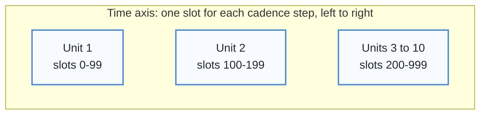
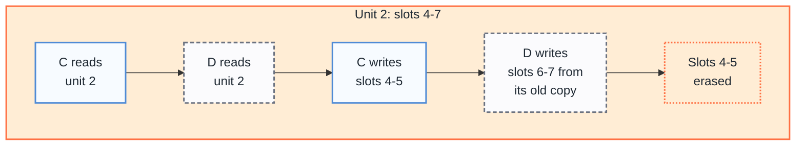
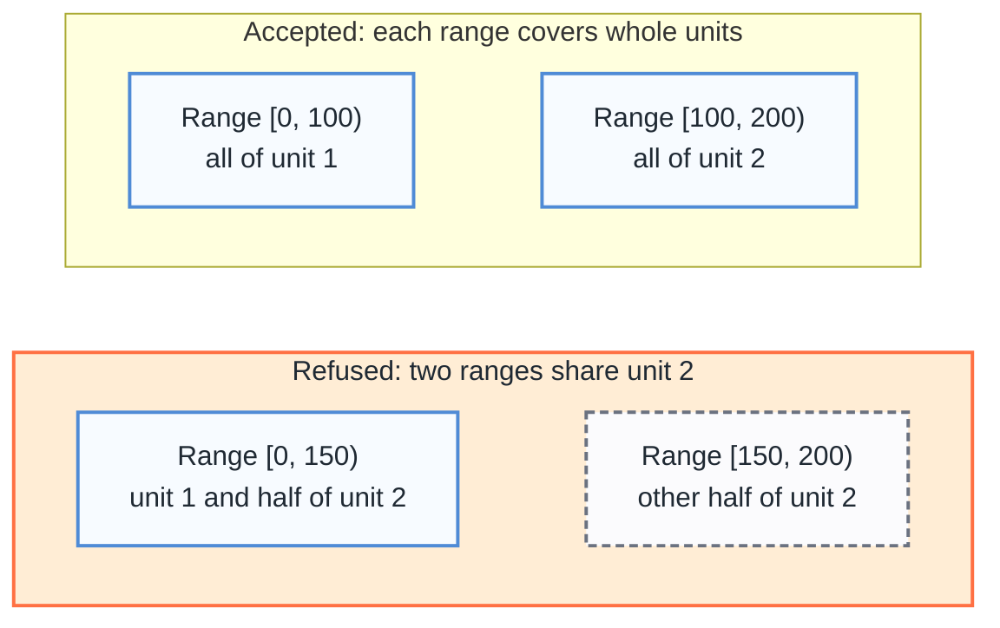

# Chunk Ownership

Parallel workers must not write the same stored object. This page explains what a slot and a stored object are, why sharing one loses data, and when Firecube refuses a slot range.

## What A Slot Is

A slot is one step of the time axis of a product. The cadence of the axis sets the length of the step. A cadence of 3600 seconds gives one slot for each hour. Slots are numbered from 0. A slot range such as `[0, 100)` holds slots 0 to 99.

A plugin declares how many slots the axis has with `TimeAxis.grid(...)`. It passes `slot_count` or `end_date`. It must pass one of them and never both. With `end_date`, Firecube computes the count as `(end_date - epoch) // cadence_s`. The `end_date` must align with the cadence.

Both options set how many slots the axis has. Neither option sets the chunk layout. The unit size comes from `chunks=` and `shards=` in `ZarrArraySpec`. An end date therefore does not give one-slot ranges. See [Index types](../../../reference/parallelism.md#index-types).

## What A Stored Unit Is

Zarr stores an array as objects. A stored unit is one such object. For a sharded array, the unit is the shard. Otherwise, the unit is the chunk.

A time chunk of 100 means that one unit holds 100 time slots. Slots 0 to 99 share one unit, and slots 100 to 199 share the next.



## Why Two Writers Of One Unit Lose Data

Zarr writes one slot by reading the whole unit, changing the slot in memory, and writing the whole unit back. Two workers can write different slots of one unit. If both read before either writes, each holds a copy without the slots of the other. The worker that writes last erases the slots of the first.

The diagram shows an array of 12 time slots in three units of 4 slots. Worker C has slots 0-5. Worker D has slots 6-11. The two ranges do not overlap, yet both touch unit 2.



Firecube accepts worker A with slots 0-3 and worker B with slots 4-11. Their ranges end on unit boundaries.

## What Firecube Refuses

Firecube refuses a slot range that splits a unit of an array that the workers write. It raises `ConfigurationError` before the worker writes. A range that covers whole units passes. A range that ends at the end of the product passes.

The diagram uses units of 100 slots. The ranges `[0, 100)` and `[100, 200)` pass. The ranges `[0, 150)` and `[150, 200)` share unit 2, so Firecube refuses them.



When a worker starts, the refusal leaves the product data unchanged. A refusal in a later batch protects that batch only. Earlier batches of the run can already have written.

These arrays are exempt: the time coordinate, engine-owned arrays, and static arrays.

`firecube zarr slots` plans ranges that fit the stored layout.

## Staged Runs

A staged run promotes whole units. It must write every cell of each unit that it touches. Firecube refuses to promote a unit that the run wrote only in part, and the target stays unchanged. With `--write-mode direct`, a run can update part of a unit.

## One-Slot Ranges

A one-slot range needs a unit of one slot. Declare a time chunk of 1 and no shards for each array that the workers write:

```python
ZarrArraySpec(
    name="value",
    shape=(n_times, 4),
    dtype=np.float32,
    chunks=(1, 4),
    dimension_names=("timestamp", "sample"),
)
```

Or declare neither `chunks=` nor `shards=`. For a new array that the workers write, Firecube then uses one slot per chunk and does not shard the array. A time coordinate that declares chunks also sets the range size. Declare no chunks for it, or chunks of 1.

This applies to a new array only. Firecube never changes the layout of an existing array. See [In A DirectZarrIngestor Schema](../../../guides/plugins/configure-zarr-chunking.md#in-a-directzarringestor-schema).

## Next Steps

- **[Fix A Chunk Ownership Refusal](../../../operations/fix-chunk-ownership-refusal.md)** - cause the refusal on a local store and fix it with planned ranges
- **[How Parallel Zarr Writes Stay Safe](parallel-writes.md)** - see the slot safety model that chunk ownership supports
- **[Run Parallel Zarr Writes](../../../operations/parallel-zarr-writes.md)** - plan ranges and start workers for your own product
